<div align="center">


</div>



<br/>

<table>
  <tr>
    <td width="48%" align="center" valign="middle">
      
    </td>
    <td width="52%" valign="top">

### Hola, soy Heiling

Desarrolladora **Junior** con el corazón en el **Backend**. Me gusta entender el problema antes de escribir la primera línea, y después construir algo que funcione de verdad.

| | |
|:--|:--|
| **Ahora** | construyendo un sistema POS completo con su propia API |
| **Fortaleciendo** | arquitectura en capas, patrones de diseño y pruebas |
| **Busco** | mi primera gran oportunidad como desarrolladora |
| **Háblame de** | Java, Spring Boot, bases de datos y automatización |

    </td>
  </tr>
</table>

<details>
<summary><b>Ver mi código fuente</b></summary>
<br/>

```java
@RestController
@RequestMapping("/heiling")
public class HeilingController {

    @GetMapping("/perfil")
    public Desarrolladora perfil() {
        return Desarrolladora.builder()
            .rol("Desarrolladora Junior")
            .backend(List.of("Java", "Spring Boot", "Node.js", "Express"))
            .frontend(List.of("Next.js", "React", "TypeScript", "Tailwind"))
            .datos(List.of("PostgreSQL", "MySQL", "Supabase"))
            .extra(List.of("n8n", "Docker", "Git Flow", "IA"))
            .cafe(Integer.MAX_VALUE)
            .build();
    }
}
```

</details>

<br/>



---

<h2 align="center">Proyectos destacados</h2>

<p align="center">
  <a href="https://github.com/heiling-18/Distribuidora-de-gestion"></a>
  <a href="https://github.com/heiling-18/Distribuidora-de-gestion-backend"></a>
  <a href="https://github.com/heiling-18/crediya-app"></a>
  <a href="https://github.com/heiling-18/campusland-ops"></a>
  <a href="https://github.com/heiling-18/tutorbot-n8n"></a>
  <a href="https://github.com/heiling-18/SistemaMediSaludFinal"></a>
</p>

<p align="center">
  <a href="https://distribuidora-de-gestion.vercel.app"></a>
</p>

---

<h2 align="center">Mi GitHub en números</h2>

<p align="center">
  
  
</p>

<p align="center">
  
</p>

<p align="center">
  
</p>

<picture>
  <source media="(prefers-color-scheme: dark)" srcset="https://raw.githubusercontent.com/heiling-18/heiling-18/output/snake-dark.svg" />
  <source media="(prefers-color-scheme: light)" srcset="https://raw.githubusercontent.com/heiling-18/heiling-18/output/snake-light.svg" />
  
</picture>

---

<h2 align="center">Conecta conmigo</h2>

<p align="center">
  <a href="https://moonlit-marshmallow-24aee0.netlify.app/"></a>
  <a href="https://github.com/heiling-18?tab=repositories"></a>
  
</p>


