<!-- ════════════════════════ HERO ════════════════════════ -->


<div align="center">

<a href="https://git.io/typing-svg"></a>

<p>
  <a href="https://moonlit-marshmallow-24aee0.netlify.app/"></a>
  <a href="https://distribuidora-de-gestion.vercel.app"></a>
  <a href="https://github.com/heiling-18?tab=repositories"></a>
  
</p>

</div>

---

## 💜 Sobre mí

Soy **desarrolladora Full-Stack con foco en Backend**. Me gusta convertir problemas reales de un negocio en software que la gente usa todos los días: ventas, caja, inventario… y hasta galpones de gallinas 🐔.

```java
public class Heiling extends Desarrolladora {

    String   rol       = "Full-Stack · Backend";
    String[] backend   = { "Java", "Spring Boot", "Node.js", "Express", "Python" };
    String[] frontend  = { "Next.js", "React", "TypeScript", "Tailwind" };
    String[] datos     = { "PostgreSQL", "MySQL", "Supabase" };
    String[] extra     = { "n8n", "Docker", "Git Flow", "Prompt testing" };

    @Override
    public String lema() {
        return "Si lo puedo construir, lo puedo explicar.";
    }
}
```

<table>
  <tr>
    <td width="33%" valign="top" align="center">
      <h3>🏪</h3>
      <b>Ahora mismo</b><br/><br/>
      Un <b>sistema POS</b> para una distribuidora agropecuaria real, con su <b>API propia</b> en Node + PostgreSQL.
    </td>
    <td width="33%" valign="top" align="center">
      <h3>🌱</h3>
      <b>Fortaleciendo</b><br/><br/>
      Arquitectura en capas, patrones de diseño y <b>APIs REST</b> bien documentadas.
    </td>
    <td width="33%" valign="top" align="center">
      <h3>⚡</h3>
      <b>Dato curioso</b><br/><br/>
      Mi código maneja caja, IVA, inventario de huevos por tamaño y la producción diaria de galpones.
    </td>
  </tr>
</table>

---

## 🧰 Mi caja de herramientas

<div align="center">

| | |
|:---:|:---|
| **☕ Backend** |  |
| **⚡ Frontend** |  |
| **🐘 Datos** |  |
| **🚀 DevOps** |  |
| **🤖 IA & Automatización** |     |

</div>

---

## 🚀 Lo que he construido

<table>
  <tr>
    <td width="50%" valign="top">
      <h3>🏪 DYM'S · Sistema POS</h3>
      <p>Punto de venta, caja con arqueo, inventario con alertas, reportes, galpones y venta de huevos para una <b>distribuidora real</b>. Roles y Row Level Security.</p>
      <p>
        <a href="https://github.com/heiling-18/Distribuidora-de-gestion"></a>
        <a href="https://distribuidora-de-gestion.vercel.app"></a>
      </p>
      <sub><code>Next.js</code> · <code>TypeScript</code> · <code>Supabase</code> · <code>Tailwind</code></sub>
    </td>
    <td width="50%" valign="top">
      <h3>🔌 DYM'S · API</h3>
      <p>API REST propia que reemplaza a Supabase: ventas, caja, inventario y reportes, con validación y pruebas.</p>
      <p>
        <a href="https://github.com/heiling-18/Distribuidora-de-gestion-backend"></a>
      </p>
      <sub><code>Node.js</code> · <code>Express</code> · <code>PostgreSQL</code> · <code>Drizzle</code> · <code>Zod</code> · <code>Vitest</code></sub>
    </td>
  </tr>
  <tr>
    <td width="50%" valign="top">
      <h3>💸 CrediYa</h3>
      <p>Sistema de préstamos y cobranzas con POO, arquitectura MVC y patrones de diseño.</p>
      <p>
        <a href="https://github.com/heiling-18/crediya-app"></a>
      </p>
      <sub><code>Java</code> · <code>MySQL</code> · <code>JDBC</code> · <code>MVC</code></sub>
    </td>
    <td width="50%" valign="top">
      <h3>🏫 Campusland Ops</h3>
      <p>Gestión de salones, inventario por serial y préstamos de equipos.</p>
      <p>
        <a href="https://github.com/heiling-18/campusland-ops"></a>
      </p>
      <sub><code>Java</code> · <code>MySQL</code></sub>
    </td>
  </tr>
  <tr>
    <td width="50%" valign="top">
      <h3>🤖 TutorBot</h3>
      <p>Bot de Telegram que conecta estudiantes con tutores y registra las tutorías en Google Sheets.</p>
      <p>
        <a href="https://github.com/heiling-18/tutorbot-n8n"></a>
      </p>
      <sub><code>n8n</code> · <code>Telegram</code> · <code>Google Sheets</code></sub>
    </td>
    <td width="50%" valign="top">
      <h3>🩺 MediSalud</h3>
      <p>Citas médicas con MVC, patrones de diseño, concurrencia y persistencia en MySQL.</p>
      <p>
        <a href="https://github.com/heiling-18/SistemaMediSaludFinal"></a>
      </p>
      <sub><code>Java</code> · <code>MySQL</code> · <code>Docker</code></sub>
    </td>
  </tr>
</table>

---

## 📈 Mi GitHub en números

<div align="center">


</div>

### 🐍 La culebrita que se come mis contribuciones

<picture>
  <source media="(prefers-color-scheme: dark)" srcset="https://raw.githubusercontent.com/heiling-18/heiling-18/output/snake-dark.svg" />
  <source media="(prefers-color-scheme: light)" srcset="https://raw.githubusercontent.com/heiling-18/heiling-18/output/snake-light.svg" />
  
</picture>

---


